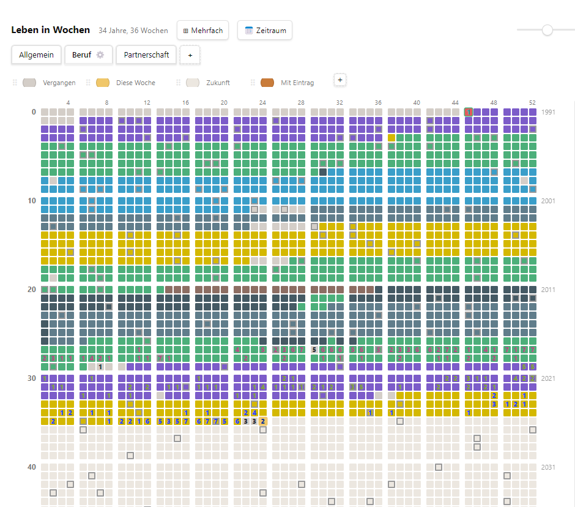

# Life in 4k Weeks Calendar – Obsidian Plugin

A "Life in Weeks" grid rendered over the weekly and daily notes in your vault. Each cell is one week of your life – click it to open or create the matching note. Great for journaling and for tracking separate timelines (children, pets, relationships, jobs …) side by side.

**New: now with mouse-over** – hover a week to preview its note, hover a day in the day view to preview the daily note (desktop).

- Click a cell to open its note, long-press for the day view
- Set weekly colors and titles
- Multi-select to edit many weeks at once
- Add tabs for separate grids, each with its own legend (sortable by drag on desktop, arrows on mobile)



## Installation

1. Open **Settings → Community plugins** and turn off restricted mode if needed
2. **Browse** → search for **"Life in 4k Weeks Calendar"**
3. **Install** → **Enable**
4. Click the calendar icon in the left sidebar

<details>
<summary>Manual install (fallback)</summary>

1. Download `main.js`, `manifest.json` and `styles.css` from the [latest release](https://github.com/Micha12323/lifeweeks-obsidian/releases/latest)
2. Copy them into `<your-vault>/.obsidian/plugins/lifeweeks/`
3. **Settings → Community plugins → Reload**, then enable **Life in 4k Weeks Calendar**

</details>

## First start

A setup screen asks for:

- **Birth date** (`YYYY-MM-DD`)
- **Life expectancy** in years (number of grid rows, default 90)
- **Base folder** in your vault (default `Bibliothek/Diary`) – where `Weekly basis/` and `Daily basis/` live

Tabs are auto-detected from the subfolders of `Weekly basis/` – no extra configuration needed.

## Usage

| Action | Cell **with** note | Cell **without** note |
|---|---|---|
| Short click | Opens the note | Quick-Edit (color / title / create) |
| Right-click | Quick-Edit | Quick-Edit |
| Long-press (½ s) | Day view (Mon–Sun) + weekly palette | Day view + weekly palette |
| Middle-click | Opens the note in a **background tab** | – |

- **Today:** the **📝** button in the header opens (or creates) today's daily note in the current tab; right-/middle-click opens it in a background tab.
- **Commands:** *Open today's daily note* and *Jump to current week* are available in the command palette (assign hotkeys in *Settings → Hotkeys*). Both open the Life in 4k Weeks Calendar view first if needed.
- **Hover preview (desktop):** hovering a week with a note shows the first lines of that note in the tooltip; in the long-press day view, hovering a day shows a short preview of its daily note.
- **Duplicates:** if two files exist for the same week (or day), the one with content (or a title) is shown and the tooltip / day view warns with a ⚠ and lists the file names, so you can merge or delete the extra file yourself. Nothing is deleted automatically.
- **Counter bar:** the line below the grid counts every entry reachable from the current tab – week notes plus the daily notes that fall into the tab's timeline.
- **Background tabs (desktop):** right-click or middle-click a day in the day view, or the *Open note* button in Quick-Edit / day view, to open that note in a new Obsidian tab without leaving the grid. The panel stays open, so you can queue several days or weeks and read them afterwards.

- **Multi-select:** the **⊞** button or **📅 Date range**, then drag across cells and edit them together (empty input moves the selected notes to the trash).
- **Zoom:** slider, **Ctrl+wheel**, or pinch on mobile – always centered on the current week. A button next to the slider cycles fit-width → fit-height → 1:1.
- **Tabs:** **+** in the tab bar creates a folder under `Weekly basis/`; **⚙** opens the tab settings (see below). Renaming the folder in Obsidian renames the tab – legend, timeline and (if enabled) the tab's own daily folder follow automatically.
- **Colors:** the palette in Quick-Edit, day view and multi-select starts with the legend entries of the current tab (round swatches, name on hover), followed by the standard colors. Edit the legend below the grid and the palette updates.
- **Language:** follows the Obsidian UI language (DE/EN); date formats adapt to your locale.
- **Open mode:** *Settings → "Open notes in"* – Automatic / Split right / Main tab bar. Every note opens in its own tab (in split mode: as a new tab inside the right-hand group). If the note is already open somewhere, the plugin jumps to that tab instead of opening a duplicate.

## Tabs and timelines

Each tab is one grid with its own legend. By default every tab uses **your** timeline (birth date and life expectancy from the plugin settings), which is handy for tracking topics side by side – *Work*, *Health*, *Travel* …

Click **⚙** on the active tab to change this:

- **Own timeline** – the tab starts at a different date and runs for a different number of years. Use it for a child, a pet, a relationship, a job or a project: enter the start date as "birth date" and the duration in years; the grid then shows that period week by week, with milestones and the birthday marker counted from the start date. Tabs with an own timeline show a small **·** next to their name. Week notes still use the same file-name scheme, so a tab can later be moved between timelines without renaming files.
- **Show milestones** – toggles the milestone markers for this tab (see next section).
- **Own daily docs** – see [Shared vs. own daily notes](#shared-vs-own-daily-notes).

## Milestones

Milestones are the "round" moments of a life that never fall on a birthday: 10,000 days, 1,000 weeks, 500 months, 1 billion seconds … The plugin computes them from the (tab's) start date and marks the matching week with a thin outline; hover or long-press the cell to see the labels in the tooltip (🎯).

Included are, per unit:

| Unit | Regular steps | Plus "fun" numbers |
|---|---|---|
| Days | every 1,000 | repdigits and sequences from 3 digits (111, 2222, 1234 …) |
| Weeks | every 100 | from 3 digits |
| Months | every 100 | from 3 digits |
| Quarters | every 100 | from 2 digits (11, 22, 123 …) |
| Minutes | every 1,000,000 | from 7 digits |
| Seconds | every 100,000,000 | from 9 digits |

Milestones are purely computed – nothing is written to your vault. They can be switched off per tab in the tab settings.

## Shared vs. own daily notes

The long-press day view lists the seven days of a week and opens or creates the daily note for each day. Where those daily notes live depends on the tab:

- **Shared (default):** all tabs read and write `{base folder}/Daily basis/`. There is exactly one daily note per date, and it appears in the day view of *every* tab – the week notes are per tab, the days are yours. This is what you want for topic tabs (*Work*, *Health* …) that all describe the same person.
- **Own daily docs:** enabled in the tab settings, the tab uses `{base folder}/Daily basis/{Tab}/` instead. Use this for tabs that describe *someone else* (a child, a pet) so their days are not mixed into your own daily notes.

Existing daily notes are never moved when you flip the switch – the tab just starts looking in the other folder.

## Sync across devices

Legends (colors and labels per tab) and the tab settings (own timeline, milestones, own daily docs) are stored **inside the vault** in `{base folder}/Life in Weeks Config.md`. Because it is a normal Markdown note, it travels with the vault through Obsidian Sync, Remotely Save, iCloud, Syncthing … and your phone shows the same legend as your desktop. The plugin manages that file – you do not need to open it. When it changes on another device the grid updates automatically; if two devices edit the legend at the same time, the last sync wins.

The plugin's own `data.json` keeps only a local copy plus the per-device settings: birth date, life expectancy, base folder, name and open mode. Set those once on each device.

## Data structure

Notes are plain Markdown, so the data stays usable outside the plugin.

```
{base folder}/                 # default: Bibliothek/Diary
├─ Life in Weeks Config.md     # legends + tab settings (synced with the vault)
├─ Weekly basis/
│  ├─ {Tab}/                   # tab name = folder name
│  │  └─ 2026-04-06-W14 Vacation.md
│  └─ …
└─ Daily basis/                # 2026-04-14.md – shared by all tabs
   └─ {Tab}/                   # only for tabs with "Own daily docs"
```

**File names:** `yyyy-mm-dd-Www[ Title].md` (weekly), `yyyy-mm-dd[ Title].md` (daily). Frontmatter is edited via `processFrontMatter()`, so foreign keys (`date`, `time`, `tags` …) are never touched.

```markdown
---
week: "Jahr 1, Woche 14"
dates: "06.04.2026 – 12.04.2026"
color: "#c97c3a"
title: "Vacation"
---

Markdown content here…
```

> The YAML labels (`week`, `dates`) are in German for historical reasons. The UI itself is fully translated.

## Mobile

Same build runs on phone and desktop (`isDesktopOnly: false`). Long-press, pinch zoom and Quick-Edit work via pointer events.

## License

MIT – see [LICENSE](./LICENSE).
